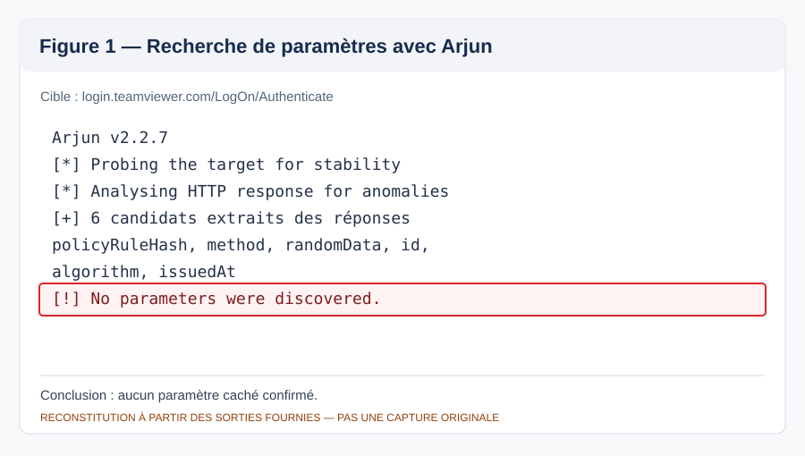

# Figures de l'investigation — login.teamviewer.com

Ces quatre figures sont des **reconstitutions graphiques à partir des sorties de commande et observations fournies pendant l'investigation**. Elles reprennent le style du rapport collectif (figures numérotées, extraits techniques, encadrés rouges), mais **ne sont pas des captures d'écran authentiques** de Burp Suite, Arjun ou SQLmap. Ne pas les présenter comme des preuves brutes.

## Figures

*Figure 1 — Recherche de paramètres cachés avec Arjun 2.2.7. Six noms candidats extraits ; aucun paramètre caché confirmé.*

*Figure 2 — Reconnaissance passive par Wayback Machine. Échantillon limité à 500 URL de www.teamviewer.com, 298 chemins distincts et trois paramètres GET.*

*Figure 3 — Tests SQLmap sur UserName et réponses 403/429. Aucune injection SQL confirmée, conclusions limitées par la protection.*

*Figure 4 — Challenge anti-automatisation observé dans Burp Suite lors d'une vérification XSS. Résultat non concluant.*

## Usage dans le rapport

Utiliser ces figures pour **illustrer** la démarche et les résultats. Les preuves originales doivent être ajoutées séparément à partir de captures réelles, avec secrets (cookies, JWT, mot de passe, identifiants de session) masqués.

Voir aussi : [Fiche Arjun](../notes/recherche-parametres-arjun.md) et [Fiche Wayback Machine](../notes/reconnaissance-wayback-machine.md).
